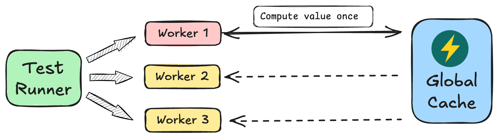

  

<h1 align="center">global-cache</h1>

Speed up E2E tests by caching data between workers

  <a href="https://vitalets.github.io/global-cache/">Documentation</a> | <a href="./CHANGELOG.md">Changelog</a>

## Why use it?

When running E2E tests in parallel, you might need to:

✅ Authenticate user only once\
✅ Seed database only once\
✅ Compute heavy values on demand\
✅ Reuse heavy-computed values across workers\
✅ Persist heavy-computed values between test runs

Global Cache makes all of this possible.

## How it works

The first worker to request a key computes its value. Concurrent workers wait for that computation
and then receive the same cached result.

## Documentation

- [Main documentation website](https://vitalets.github.io/global-cache/)
- [Playwright integration](https://vitalets.github.io/global-cache/playwright/)

## License

[MIT](./LICENSE)
